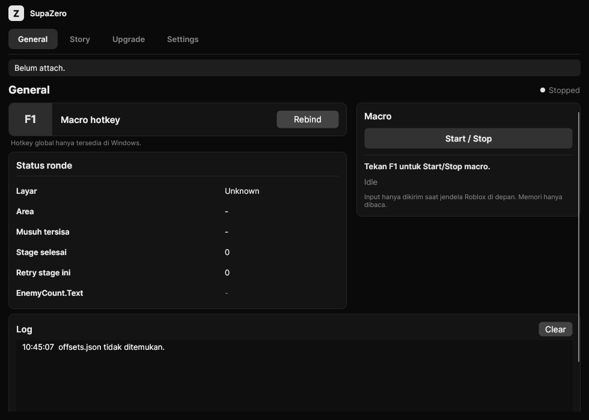

# SupaZero

**AutoFarm macro for Anime Zero** (Roblox, place `114574503491412`): Story (advancing stage by stage), Infinite, Defend, Raid, Trials. Walks to the Create Room circle by itself, picks mode/map/act/difficulty, fights, walks to the next area (attacks rubble when stuck), upgrades the SkillTree, then Next/Retry. Same UI as SupaFisch (C# .NET 8 + Avalonia, Black/White/Custom themes).



## Constraints (mandatory)

- Roblox memory is **read-only** (reader from RobloxInstanceExplorer). Input via **SendInput** only.
- NO WriteProcessMemory, injection, DLLs, FFlags, or anti-cheat bypass.
- Input is only sent while the Roblox window is in front (alt-tab = the macro automatically holds input).

## Structure

| Folder | Contents |
|---|---|
| `src/RIE.Core` | Copy of the read-only RobloxInstanceExplorer v3.12 reader (ProcessMemory, offsets, InstanceReader, PropertyReader). |
| `src/SupaZero.Core` | `Game/` reads game state → `GameSnapshot`; `Automation/` `FarmMachine` (macro brain, pure & tested), `Navigator` (W/A/S/D to a target from character position + camera direction), `UpgradePlanner`, `MacroRunner` (loop); `Interop/Win32Input` (SendInput); `Settings/`. |
| `src/SupaZero.App` | SupaFisch-style Avalonia UI: General, AutoFarm, Upgrade, Offsets, Settings tabs. |
| `tests/SupaZero.Core.Tests` | xUnit: HUD parser, FarmMachine, Navigator, upgrade planner, GameReader with fake memory. |
| `docs/` | `research.md` (RIE phase 1 research results), `ROADMAP.md`. |

## Running (PowerShell)

```powershell
git clone https://github.com/rfibyzan/SupaZero.git
cd SupaZero
dotnet run --project src/SupaZero.App -c Release
```

Tests: `dotnet test tests/SupaZero.Core.Tests`

Offsets: **Offsets** tab → **Download latest** (saved to `%AppData%\SupaZero\offsets.json`), or RIE's `offsets.json` is used automatically if present. Settings in `%AppData%\SupaZero\settings.json`, logs in `%AppData%\SupaZero\logs`.

## Macro flow

1. **Lobby**: click the **Areas** button → **Story** card (Click to Teleport) → detect the "Start Here" circle → walk there (W/A/S/D).
2. **Create Room**: pick Mode → Map (stops if the map/act is locked) → Act → Difficulty → Start (`StaerButton`).
3. **Start Game?** → Yes.
4. **Round**: while `Workspace.enemies` contains enemies → left click + skill keys per their own cooldowns.
5. **Area cleared** → walk to `Workspace.World.Spawns/Areas[n+1]`; stuck for 1.5 s → jump + attack (HxH rubble).
6. **Victory EndScreen** → upgrade SkillTree (if enabled and open) → Next (Story) / Retry (other modes) / manual choice.
7. **DEFEAT** (`ResultText`) → Retry up to the limit, then stop.

Default hotkey **F1** (Start/Stop), changeable on the General tab.
